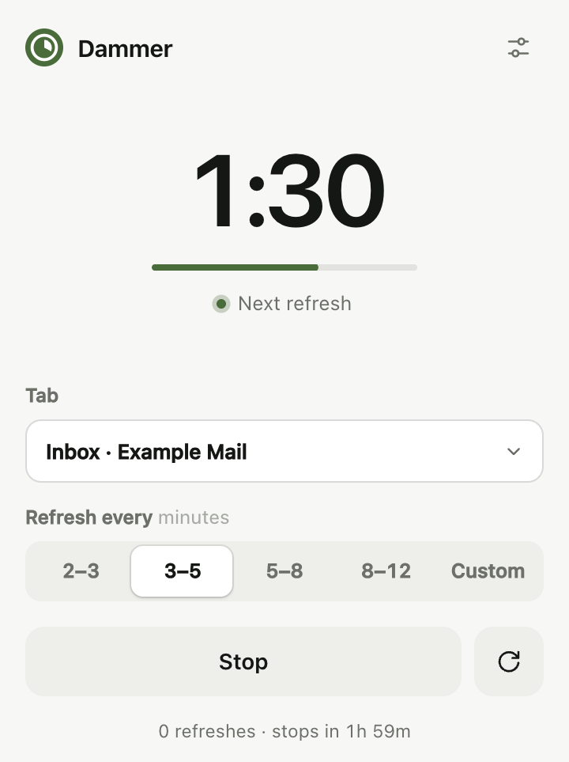
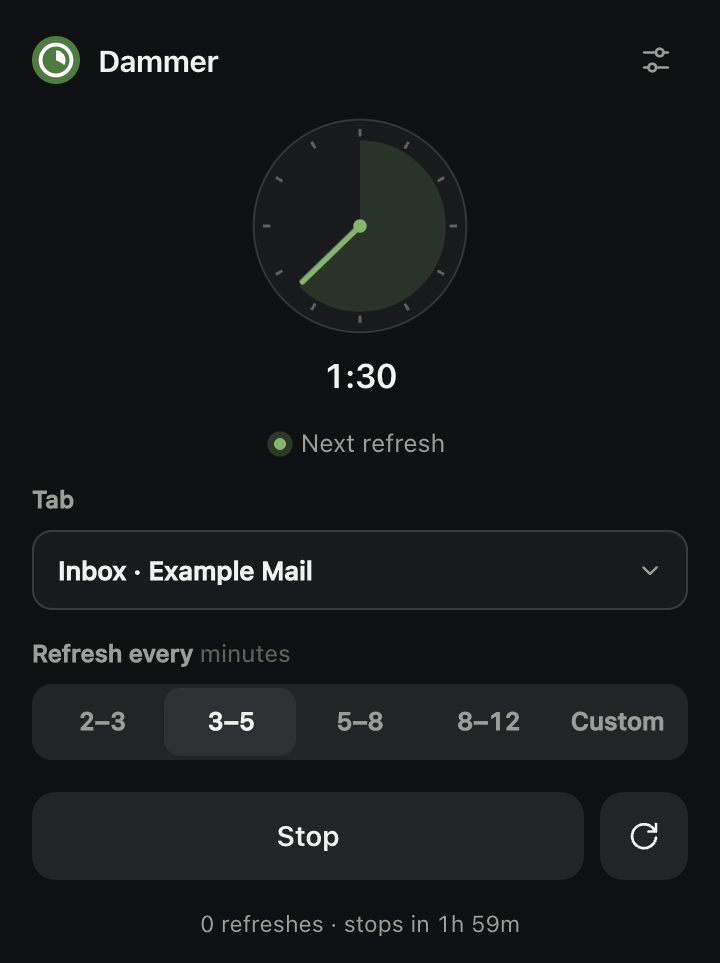
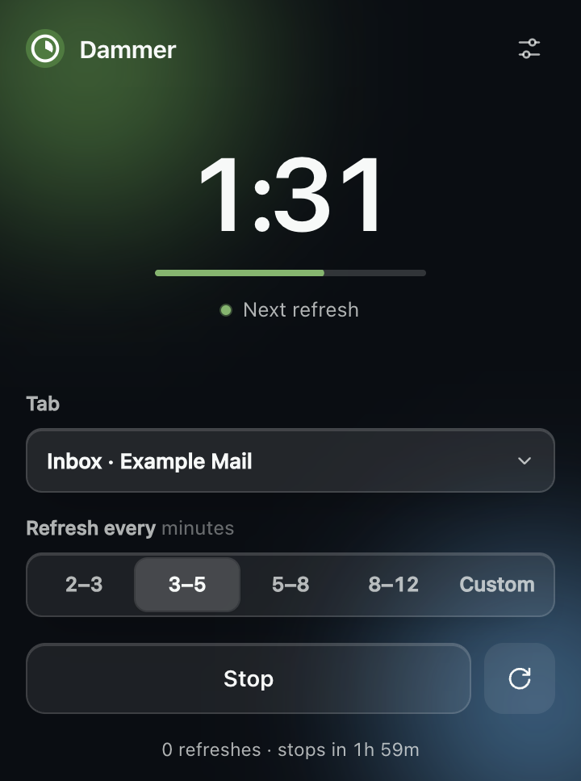

<p align="center">
  
</p>

<h1 align="center">Dammer</h1>

<p align="center">
  A private, lightweight auto-refresher for any browser tab.<br>
  Pick a tab, pick an interval, press Start.
</p>

<p align="center">
  <a href="https://aleenatahir1.github.io/dammer/">Website</a> ·
  <a href="https://github.com/AleenaTahir1/dammer/releases/latest">Download</a> ·
  <a href="https://aleenatahir1.github.io/dammer/install/">Install guide</a> ·
  <a href="https://aleenatahir1.github.io/dammer/faq/">FAQ</a> ·
  <a href="https://aleenatahir1.github.io/dammer/privacy/">Privacy</a>
</p>

<p align="center">
  
  
  
</p>

## Why

Most auto-refresh extensions ask to read and change every website you visit, and several popular ones have been caught injecting ads or tracking browsing. Dammer does one job and is small enough to read in a sitting: about 2,300 lines of plain HTML, CSS and JavaScript, no dependencies, no build step, and no code path that can reach the network.

## Features

- **Any tab, remembered.** Choose a tab from the list once. Dammer keeps using it, finds it again after a restart, and offers to reopen it if it is closed.
- **Randomised intervals.** Each refresh lands at a random moment inside the range you choose (2–3, 3–5, 5–8, 8–12 minutes, or a custom range from 30 seconds to 60 minutes).
- **Two clocks.** A digital countdown with a progress bar, or an analog face whose hand sweeps once per cycle.
- **Three themes, five colours.** Light, dark and a frosted glass theme, each with five accent colours. Follows your system theme by default.
- **Never interrupts you.** It will not reload a tab while you are looking at it, so a half-typed message is safe. Or have it stop altogether when you open the tab.
- **Stops by itself.** After a set time (1–8 hours), when you have been away from the computer, when the tab is closed, when it moves to a different site, or when the site bounces it to a login page.
- **Careful settings in one tap.** Slower refreshes, a one-hour auto-stop, and a timer that only runs while you are at the computer.
- **Light on your computer.** The background script sleeps between refreshes and wakes for a few milliseconds each cycle. The countdown only runs while the popup is open.
- **Keyboard shortcut.** `Alt+Shift+R` starts or stops from any tab.

## Install

Dammer is not on the Chrome Web Store. Install it from a release:

1. Download `dammer-<version>.zip` from the [latest release](https://github.com/AleenaTahir1/dammer/releases/latest) and unzip it.
2. Open `chrome://extensions` and turn on **Developer mode** (top right).
3. Click **Load unpacked** and choose the unzipped folder.
4. Pin Dammer to the toolbar.

It works in Chrome 120 or newer and in other Chromium browsers (Edge, Brave, Arc, Opera). Firefox and Safari are not supported.

To run from source instead, clone this repository and load the `extension/` folder in step 3.

## Use

1. Click the Dammer icon.
2. Under **Tab**, choose the page to refresh.
3. Under **Refresh every**, choose a range.
4. Press **Start**. The toolbar icon turns green and shows `ON`.

The circular arrow next to **Stop** refreshes immediately. The sliders icon opens settings.

| Setting | What it does | Default |
| --- | --- | --- |
| Theme | Auto, Light, Dark or Glass | Auto |
| Timer | Digital or Analog | Digital |
| Colour | Accent colour | Moss green |
| Careful settings | One tap sets: refresh every 8–12 minutes, auto-stop after 1 hour, pause on the tab, stop after 5 minutes away | Not applied |
| Auto-stop | Stops the timer after 1, 2, 4 or 8 hours, or never | 2 hours |
| On the tab | What happens when a refresh is due while you are looking at the tab: Refresh anyway, Pause (skip it), or Stop the timer | Pause |
| Stop if away | Stops the timer once the computer has not been used for 5, 15 or 30 minutes, or is locked | Off |
| Keep the tab awake | Stops Chrome's Memory Saver from unloading the tab | On |
| Hard refresh | Bypasses the cache on every reload | Off |
| Toolbar badge | Shows `ON` on the icon while running | On |

## Privacy and permissions

Dammer collects nothing and sends nothing. Its content security policy sets `connect-src 'none'`, so the browser itself blocks any network request from the extension, and an automated check fails the build if networking code is ever added.

| Permission | Why it is needed |
| --- | --- |
| `tabs` | To list your open tabs by title and address in the tab picker, and to notice when the chosen tab has moved to another site. Chrome describes this as "Read your browsing history". The information stays on your computer. |
| `alarms` | To wake up when the next refresh is due. |
| `storage` | To save your settings and the tab you chose, on your computer only. |
| `idle` | To tell whether you are at the computer, for the pause setting. |

There are no content scripts and no host permissions: Dammer cannot read or change the content of any page. Full details are in [PRIVACY.md](PRIVACY.md) and [docs/guide/PERMISSIONS.md](docs/guide/PERMISSIONS.md).

## Check a site's rules first

Automatic refreshing is ordinary browser behaviour, but some websites prohibit automated access or tools that make you appear active, and may restrict accounts that use them. Marketplaces and social platforms are common examples. Read the terms of any site before pointing Dammer at it. You are responsible for how you use it.

Dammer is an independent project and is not affiliated with any website it can be used on.

## Development

There is nothing to install. The extension is plain HTML, CSS and JavaScript.

```
extension/           the extension itself — load this folder in Chrome
  manifest.json
  src/background.js  service worker: alarms, reloads, stop conditions
  src/shared.js      settings, tab matching and helpers used by both sides
  popup/             the popup: markup, styles, logic, flash-free theme loader
  icons/             toolbar icons, generated by tools/make_icons.py
tests/e2e/           end-to-end test that drives real Chrome
tools/               check, build and icon scripts
docs/                the website (GitHub Pages), its live demo, screenshots and guides
```

| Command | What it does |
| --- | --- |
| `npm run check` | Validates the manifest, parses every script and fails if networking code appears. No browser needed. |
| `npm test` | Launches Chrome with a throwaway profile, loads the extension and runs 58 checks against local stand-in sites. Also retakes the screenshots. Needs Node 22+, Chrome and `openssl`. |
| `npm run build` | Writes `dist/dammer-<version>.zip`. |
| `npm run site` | Copies the popup into `docs/demo/` so the website's live demo matches the extension, and rebuilds the site's inner pages and `sitemap.xml` from `tools/pages.mjs`. |

How the pieces fit together is described in [docs/guide/ARCHITECTURE.md](docs/guide/ARCHITECTURE.md), and what the tests cover in [docs/guide/TESTING.md](docs/guide/TESTING.md). Contributions are welcome; see [CONTRIBUTING.md](CONTRIBUTING.md).

## Author

Made by **Aleena Tahir** — [GitHub](https://github.com/AleenaTahir1) · [LinkedIn](https://www.linkedin.com/in/aleenatahir)

With help from **Saqlain Abbas** — [GitHub](https://github.com/Razee4315)

## License

[MIT](LICENSE)
